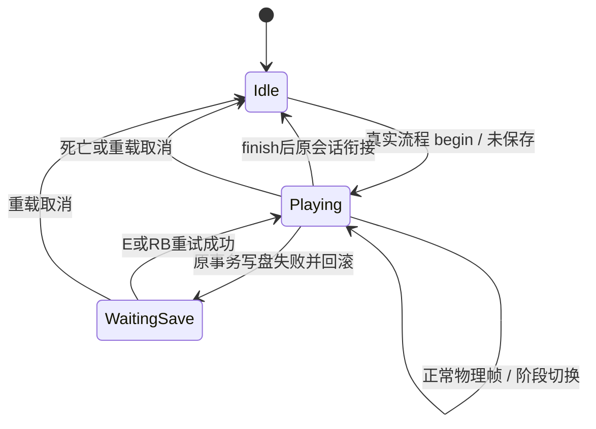

# 关键演出接入（SYS-012）

`StartRoomSession.cinematics` 是每个真实会话拥有的 `CinematicDirector`，不是自动加载，也不写入存档。`cinematic_state()` 是时钟、操作锁、HUD 与剧情背景槽共用的只读策略查询。原来的 `intro_active`、各段剩余时间与最终战 pending 属性保留为这个组件的投影，供现有会话和测试使用，不另存一份播放状态。

## 清单与保存边界

| 编号 | 现有表现 / 衔接 | 保存边界 |
| --- | --- | --- |
| `opening` | 坠落、落地、起身 → 探索 | 起身结束时出生、检查点、引导标记同次保存；失败回滚，保留锁定，E / RB 重试 |
| `boss.overlook` | 渴望俯视镜头、落地 → 开战 | 沿用登场前保存 intro 标记的既有边界；该次成功保存后播放，后续读档不再播 |
| `boss.parasite` | 寄生同伴者特写、尸体运动 → 开战 | 同上，不把旧的入口提交改成结束提交 |
| `seven.first` | 首见镜头、现有对话 → 探索 | 完成对话时既有剧情、回满与日期事务一起保存 |
| `seven.gaze` | 注视光束、现有对话 → 探索 | 注视、成长上限与剧情标记同次保存；不额外回满 |
| `ten.rescue` | 落下、对话、斩击、空场、保存、援军 → 协战 | 既有救场事务成功后才能进援军阶段；失败保留 SAVE 阶段重试 |
| `final.start` | 既有最终战开战保存重试 → 战斗 | 启动预算的原事务；失败不开始计时 |
| `final.win` | 既有胜利保存重试 → 靠近 10 对话 | 胜利事务；保持可移动、HUD 可见与原音乐选择，不新增胜利动画 |
| `final.talk` | 现有胜利对话 → 结局 | 原对话完成标记落盘后才开始结局 |
| `ending` | 现有三秒结局 → 结束纸面 | END 成功落盘后才进入结束纸面；失败保持重试 |
| `ending.finished` | 已保存的结束纸面 → 标题 | 终态策略，不是重播片段，不再次写 END |

`world.save` 仅桥接战场郊区原有保存锁；`legacy.lock` 兼容现有客户端直接设置 `intro_active` 的用法，均不新增剧情。演出时长仍取原 Room / 对话配置或原会话常量。普通对话和离开确认也经查询停表、选择剧情音乐，但不会因此增加操作锁或隐藏 HUD。

所有已接入演出均 `can_skip=false`。推进原对话、失败重试、保存后不重播，均不等于跳过演出。本次没有新增按键、映射或演出跳过功能；资源中预留的 `skippable` 必须保持 false，开启需先获用户批准。

## 数据与组件接口

`CinematicCatalog.sequence(id)` 返回独立的 `CinematicSequence` 资源：

- `id`、`phases`：编号与兼容阶段索引；不代表自动顺序。救场沿用旧枚举的 SAVE / AFTERMATH 数值，实际按原会话的 AFTERMATH → SAVE 顺序执行。
- `locks_control`、`hides_hud`、`pauses_clock`、`story_music`：现行策略。
- `completion_events`：既有事件的说明清单；首项用于已保存检查。它不是一个自动写事件的指令。
- `commit_point`：`entry` / `finish` / `saved`，明确 Boss 的入口提交与结束终态。
- `continuation`：衔接名称，供查询与接入说明；实际奖励、开战、换房仍由原会话执行。
- `presentation`：内容脚本；`duration_override=-1` 沿用旧配置，可用非负值替换该段内容时长。

`begin()`、`set_phase()`、`advance()`、`finish()` 管理单一播放实例；`state()` 返回脱离内部状态的字典。`advance()` 只接受正常物理帧，每帧最多一次，并在树暂停时拒绝推进。`history` 是最多 128 项的进程内诊断记录，不是玩家数据。

暂停冻结 Playing / WaitingSave 中的内容与计时，不另行结束实例。读档由原会话依据已保存事件选择衔接；组件也拒绝重新开始已完成事件。Boss 仅在本次入口写盘成功后传 `entry_committed=true`，允许刚提交的登场播放一次。未提交的首见、注视等从已保存检查点重新触发；已保存奖励不重复发放。

## 正式内容如何替换

现在的 `PlaceholderCinematics` 只负责相机、占位角色变换和现有覆盖层。内容脚本是 RefCounted，按需实现以下回调（参数为会话 Node 与 director）：

| 回调 | 用途 |
| --- | --- |
| `begin(host, flow)` | 建立该段的镜头或过场节点 |
| `ready_to_tick(host, flow)` | 是否开始消耗内容时间，例如真实落地后才起身 |
| `physics(host, flow, delta)` | 正常物理帧中的内容推进 |
| `frame(host, flow, delta)` | 纯画面更新，不能推进流程时钟 |
| `phase_started(host, flow)` | 切换该段的表现阶段 |
| `save_failed(host, flow)` | 显示既有保存失败提示 |
| `finish(host, flow)` | 释放节点、还原镜头与视觉变换 |

接入时先取得 catalog 资源，替换 `presentation`，必要时设置 `duration_override`，在开始前登记到该会话 `cinematics.overrides[id]`。开始时复制资源，不影响其他会话。`test_cinematics.gd` 使用独立内容脚本替换开场，验证真实落地、帧推进、结束回调及原出生保存衔接仍有效。

内容层不得自行发奖励、改日期、写事件、写盘或推进波次。`attempt_commit(id, callable)` 只记录写盘结果 / 重试状态；事务的数据备份与回滚仍由原会话负责。开场原来忽略失败的写盘在本次补成同样的备份、回滚、重试边界，避免未保存却解除锁定。其余事务保持既有写盘、回滚与衔接顺序，存档结构不变。

计时器读 `cinematic_state().pauses_clock`；查询还合并普通对话、暂停、最终战超时 / 胜利等既有停表条件。操作锁与旧 HUD 可见性由组件 changed 信号同步，正式 HUD 沿用 LifeUI 既有可见性连线。AudioEvents 只将剧情背景槽的判断改为读取同一查询。未改 LifeUI、HUD、输入或存档格式。

## 验证

`res://tests/test_cinematics.gd` 使用真实 FinalBattleSession、Room、输入事件、物理帧和隔离存档，覆盖整条清单。敌人 AI 在夹具中静止，战斗仍由真实受击、波次到达条件、房间与存档流程推进，不手动增加演出时钟。暂停探针是 ALWAYS 物理节点，仅在真实暂停时调用组件，确认组件自身不会被调用方绕过暂停门禁。其余开场、两 Boss、7、10、最终战、时钟与音频旧套件保持原断言。
